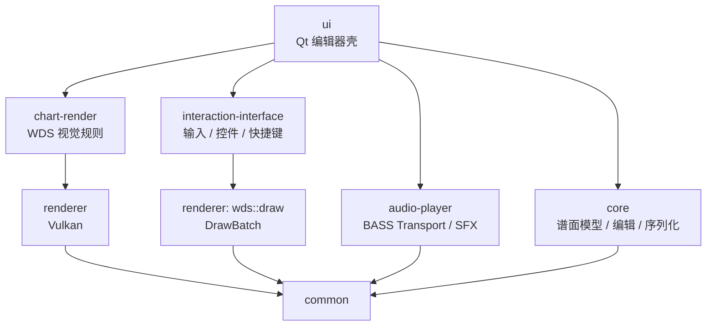

# WDS Editor

<p align="center">
  
</p>

<p align="center">
  <strong>面向 <em>World Dai Star: Yume no Stellarium</em>（YMST / ユメステ）的跨平台自制谱编辑器。</strong>
</p>

<p align="center">
  原生制谱 · 官方 CSV / SUS 互转 · 实时 3D 预览 · 音频同步编辑
</p>

<p align="center">
  <a href="./README.md">English</a> ·
  <a href="./README-CN.md"><strong>简体中文</strong></a>
</p>

<p align="center">
  <a href="https://github.com/TeamOpenSirius/wds-editor/releases"></a>
  <a href="https://github.com/TeamOpenSirius/wds-editor/actions/workflows/build-packages.yml"></a>
  
  
  
</p>

---

## 项目简介

**WDS Editor** 是一个用于制作和预览 **World Dai Star: Yume no Stellarium（YMST / ユメステ）自制谱**的桌面制谱器。

项目不是单纯的格式转换工具，而是提供完整的原生制谱工作流：谱面以 Tick 时间轴进行编辑，与音乐统一同步，并通过实时 3D 预览尽可能还原游戏中的 Note、舞台、分割线、Combo 与打击效果。

WDS Editor 拥有自己的可编辑工程与谱面格式，同时兼容已有 WDS 社区工作流：

- 原生 **`.wdsproject`** 工程；
- 原生可编辑 **`.wdschart`**；
- 解密后的官方 **7 列 CSV**；
- Ched / ChedPlus 工作流常用的 **SUS**；
- 官方 **`music_config.csv`** 延迟配置。

代码按照可复用模块拆分，其中谱面内核和预览逻辑也被 TeamOpenSirius 的 [SiriusChartViewer](https://github.com/TeamOpenSirius/SiriusChartViewer) 复用。

## 主要特性

- 基于 Tick 时间轴的**原生自制谱编辑**。
- 面向 WDS 表现规则实现的**实时 3D 谱面预览**。
- 基于 BASS 的音乐播放、打击音和统一 Transport 时钟。
- **多谱面工程**：同一首歌可以保存多个难度 / 谱面。
- **官方 CSV 导入与导出**。
- **SUS 导入与导出**，兼容 Ched 12 键布局。
- 可选的 **SUS → 原生可编辑谱面**自动转换。
- 支持**导出当前谱面**或**导出整个工程**。
- BPM 与拍号变化编辑。
- 谱面延迟 / 音乐 Offset。
- 撤销 / 重做、复制粘贴、移动、Resize、转换、镜像。
- Scratch Hold / JumpScratch 链式编辑。
- **无尾 Hold（Nontail Hold）**。
- Split Lane / 分割线效果编辑。
- Hold 中间判定点 / Mid Star 处理，Sound / SoundPurple 独立转换与类Ched吸附放置。
- **曲线模板**，快速制作 Hold / Scratch Hold 曲线。
- 波形与频谱辅助制谱。
- 谱面检查：重叠检测与错误位置标记。
- Qt Dock 工作区，可移动 / 浮动 / 关闭 / 重置布局。
- 自定义主题、快捷键和编辑行为。
- 提供 **Windows x86_64** 与 **macOS Apple Silicon** 安装包。

## 编辑器布局

默认工作区将预览、播放控制、谱面编辑区、曲线模板和设置同时放在主窗口内：

```text
┌──────────────────────────────────────────────────────────────────────────┐
│ 文件 / 编辑功能区                         Note 转换工具栏                │
├───────────────────┬──────────────────────────────┬───────────────────────┤
│ 实时预览          │                              │ 曲线模板              │
├───────────────────┤                              ├───────────────────────┤
│ 播放控制          │          谱面编辑区          │ 设置                  │
├───────────────────┤                              │                       │
│ 编辑工具栏        │                              │                       │
└───────────────────┴──────────────────────────────┴───────────────────────┘
```

所有 Dock 均可移动、浮动、关闭或重新组合，并可通过 **视图 → 重置布局**恢复默认状态。

## 文件格式

| 格式 | 导入 | 编辑 | 导出 | 用途 |
| --- | :---: | :---: | :---: | --- |
| `.wdsproject` | ✓ | ✓ | ✓ | 原生工程：音乐、延迟以及一个或多个谱面 |
| `.wdschart` | ✓ | ✓ | ✓ | 原生可编辑谱面格式 |
| 官方 WDS CSV | ✓ | 仅预览 | ✓ | 与解密后的游戏谱面数据互转 |
| `music_config.csv` | ✓ | 延迟信息 | ✓ | 官方 `DelaySeconds` / 音乐配置 |
| `.sus` | ✓ | 可选转换 | ✓ | Ched / ChedPlus / SUS 工作流 |

### `.wdsproject`

一个原生工程对应一首歌，并可以包含多个谱面。

概念格式：

```text
WDSPROJECT 3
MUSIC music.ogg
CHART_DELAY_MS 3019
ACTIVE_CHART 0
RESUME_CHART 0
RESUME_TICK 1920
CHART chart-a.wdschart
CHART chart-b.wdschart
END
```

工程在可能的情况下使用相对路径，因此整个工程目录可以比较方便地一起移动。

`RESUME_CHART` / `RESUME_TICK` 记录上次正常退出时正在编辑的谱面与 tick 位置；再次打开工程会直接跳转回去。旧工程没有这两个条目时会进入第一张谱面的开头。

### `.wdschart`

`.wdschart` 是 WDS Editor 的原生无损制谱格式。

它不会像官方 CSV 那样直接存浮点秒数，而是使用整数 **Tick** 保存 Note 时间，因此更适合编辑、量化、BPM 变化以及拍号变化。

原生格式还可以保存一些编辑器需要的关系，例如 Mid Star 与所属 Hold 的绑定。

同步线不写入谱面文件，加载时根据 Note 现场计算。

### 官方 CSV

编辑器支持游戏侧解密后的七列 CSV：

```text
startTime,endTime,type,leftLane,laneLength,gimmickType,scratchLength
```

官方实际文件没有表头，上面只用于说明列顺序。

官方 CSV 导入后目前采用**只读 / 预览模式**，避免在不能完整无损映射时直接修改原始数据。

原生谱面仍然可以导出为官方 CSV。

### SUS

WDS Editor 内置专门的 WDS / Sirius SUS 兼容层，用于对接 Ched / ChedPlus 以及已有社区制谱工作流。

目前处理的内容包括：

- 基于 Slide 的 Hold / ScratchHold；
- Ched 12 键 Padding；
- Air（`#5`）Scratch 几何；
- Critical Hold Head；
- 可见 Hold Mid Star；
- 导出时生成 HoldEighth；
- WDS Metadata 与 Wave Offset。

对于无法完全无损映射的 SUS 结构，导入器会给出 Warning，而不是假装转换完全等价。

打开 **SUS 自动转换**后，导入的 SUS 可以在内存中转换成原生可编辑谱面。

## Note 模型

编辑器覆盖目前自制谱工作流需要的主要 WDS Note 类型，包括：

- Tap / Normal；
- Critical / ExTap；
- Flick：左 / 双向 / 右；
- Hold / Critical Hold；
- Scratch Hold / Scratch Critical Hold；
- Hold Start / Scratch Hold Start；
- Sound / ScratchSound Mid Star；
- HoldEighth；
- Nontail Hold；
- Split Lane Gimmick；
- JumpScratch / OneDirection。

内部统一使用 **0-based 12 Lane** 编辑空间，并在导出官方格式时完成 Lane 转换。

### Scratch Hold

Scratch Hold 并不是简单画一条 Ribbon。

内核显式处理：

- 连续段之间的链式关系；
- JumpScratch 尾部范围；
- 左 / 右 / 双向方向编码；
- 相邻 Hold 的 Lane Union；
- 共享连接点；
- 最后一段的 End Cap。

拖动 Scratch Hold 链时，会尽量限制到 WDS `scratchLength` 能实际表达的合法几何范围内，避免编辑器里能画、导出后却无法表示的情况。

### 无尾 Hold

编辑器原生支持：

```text
NontailHold
NontailCriticalHold
NontailScratchHold
NontailScratchCriticalHold
```

这类 Hold 有持续时间，但**没有尾判，也不会产生普通 Hold End 的判定 / 特效**。

它可以用于自制谱扩展中“持续结束但不需要尾部判定”的长条结构。

## 时间轴

WDS Editor 的原生编辑逻辑基于 Tick。

支持：

- 自定义 TPQ；
- BPM 变化；
- 拍号变化；
- 工程级谱面延迟；
- 拍内细分。

Tick `0` 始终存在 Timing Anchor，后续 Timing Point 可以单独修改 BPM 或拍号。

谱面延迟属于 **`.wdsproject` 工程**，而不是某一个 `.wdschart`。因此同一首歌的多个难度可以共用同一套音乐对齐参数。

## 基本制谱流程

典型工作流：

1. 新建或打开 `.wdsproject`。
2. 导入音乐。
3. 设置谱面 Delay、BPM 和拍号。
4. 新增一个或多个谱面。
5. 在时间轴上放置和编辑 Note。
6. 使用实时预览检查视觉效果与时序。
7. 执行谱面检查。
8. 保存原生工程。
9. 将当前谱面或整个工程导出为官方 CSV / SUS。

## 编辑能力

目前主要编辑操作包括：

- 点击放置；
- 拖动创建 Hold；
- 单选 / 多选 / 框选；
- 移动选区；
- 调整 Note 宽度；
- 调整 Hold 起止时间；
- 调整 Scratch Hold End Span；
- 删除；
- 复制 / 粘贴；
- 撤销 / 重做；
- 水平镜像；
- 以选区中心镜像；
- Tick / Lane 微调；
- Note 类型转换。

### Note 转换

顶部转换工具栏支持快速转换为：

- Tap；
- ExTap；
- Hold Head；
- Hold；
- Left Flick；
- Flick；
- Right Flick；
- Scratch Hold；
- Sound；
- SoundPurple。

前 8 个按钮用于普通 Note / Hold 类型转换；`Sound` / `SoundPurple` 只用于两种 Hold Mid Star 之间互转，不能把其它 Note 变成星星，其它转换按钮也不会把星星本体转成普通 Note。

- 选中 Hold 后点击星星转换按钮：转换该 Hold 内部全部子星星，Hold 本体不变；
- 直接选中星星本体：只转换这颗星星自身；
- Hold → 非 Hold：删除其全部子星星、HoldEighth 与配对 Head；
- Hold → Hold：保留原有行为，同步 Head 家族并把子星星更新为对应 Hold 家族的类型；
- 混合选择时只处理上述合法项。

两类 Hold 与 Sound / SoundPurple 的绑定不再要求颜色配对，原生 `.wdschart` 与官方 CSV 导入导出都会保留不配对的星星类型；SUS/Ched 的 Slide Mid 颜色仍由 Hold 家族还原（格式限制）。

### 类Ched星星放置

开启“启用类Ched放置逻辑”后，转换栏按钮切换为放置类型选择：

- 默认按 `9` / `0` 选择放置 `Sound` / `SoundPurple`，可在快捷键设置中修改；
- 放置星星时，横向轨道强制吸附到鼠标所在 Hold 的 lane / width；
- 鼠标不在 Hold 内（包括 Hold 起止边界）时不显示虚影，也无法放置；
- 放置成功会在同一 Undo 步骤中重新生成该 Hold 的 HoldEighth。

## 曲线模板

WDS Editor 内置可复用的**曲线模板系统**。

可以在编辑器工具栏选择模板，在右侧曲线面板调整算法、参数和方向，然后用于快速生成 Hold / Scratch Hold 曲线。

相比手工逐段摆放，更适合重复制作弧线和复杂长条。

## Split Lane

编辑器支持 WDS 的几组 Split Lane：

- Split；
- Full Split；
- Light Split；
- Ignore Split。

Split Count 与效果 / Color ID 分开保存，使预览可以按照游戏侧 Split Line 逻辑显示。

还可以开启“**音符默认对齐分割线轨道**”，让新放置 Note 自动跟随当前 Split 范围。

## 实时 3D 预览

编辑器与预览共用同一个 Timeline：

```text
用户输入
  ↓
Audio Transport
  ↓
TimelineSnapshot
  ↓
ChartEditorEngine
  ↓
PreviewSnapshot
  ↓
PlaybackPreviewView / ChartPreviewPanel
  ↓
DrawBatch
  ↓
VulkanRenderer
```

预览不是简单把编辑区二维图形投影过去，而是单独实现了面向 WDS 的视觉逻辑：

- 舞台几何；
- Note Skin；
- Hold Ribbon；
- Scratch Hold；
- Split Line / Split Color；
- Sync / Concurrent Line；
- Combo；
- Auto Judge；
- Hit Effect；
- 打击音调度。

Web 项目 [SiriusChartViewer](https://github.com/TeamOpenSirius/SiriusChartViewer) 也直接复用了这里的预览核心，并将选定 C++ 模块通过 Emscripten 编译成 WebAssembly。

## 音频

音乐与打击音由 **BASS / BASSmix** 驱动。

Transport 统一管理：

- BGM；
- Hit SFX；
- Seek；
- 播放 / 暂停；
- 播放速度；
- 音乐音量；
- 打击音音量；
- 编辑器 / 预览共用时间轴。

播放倍速会同步影响 BGM 与谱面 Timeline，但打击音本身仍使用正常采样率。

编辑器还会生成 Waveform，并提供频谱辅助制谱能力。

## 谱面检查

目前内置的谱面检查重点包含 **Note 重叠检测**。

检测会区分：

- 普通可判定 Note；
- Hold Tail；
- Scratch Hold Tail Span；
- 合法 Head / Body 配对；
- Hold Chain Joint；
- Split；
- Mid Star。

检测到的问题 Tick 可以直接在编辑区中标红 / 标记。

## 快捷键

常用默认快捷键：

| 快捷键 | 功能 |
| --- | --- |
| `Space` | 播放 / 暂停 |
| `Ctrl/Cmd + O` | 打开工程 |
| `Ctrl/Cmd + S` | 保存 |
| `Ctrl/Cmd + Z` | 撤销 |
| `Ctrl/Cmd + Y` | 重做 |
| `Ctrl/Cmd + C` / `V` | 复制 / 粘贴 |
| `Ctrl/Cmd + B` / `N` | 将选中音符移到背图层 / 恢复所有背图层 |
| 方向键 | 微移选区 |
| `Q / W / E / A / S / D` | 默认宽度 1 / 2 / 3 / 4 / 6 / 12 |
| `9` / `0` | 类Ched放置逻辑开启时，选择放置 Sound / SoundPurple |

快捷键可以在设置中重新配置。

背图层仅是编辑期的内存辅助状态：不写入谱面文件，预览、重叠检查、保存和导出都仍按普通音符处理；打开或导入工程时所有音符回到表图层，同一工程内切换谱面时各谱面的背图层会保留。背图层音符显示为半透明，并且不响应选中、拖动、调整、删除等编辑操作。移动规则与 hold 的层级选中一致：只隐藏当前选中的部分和其内部包含的部分（例如选中 hold body 会带上其内部星星，选中 head 则只隐藏 head，配对部分不会自动加入）；HoldEighth 是派生音符，不进入图层。分割线和变速标签不属于背图层功能范围；复制粘贴产生的音符始终位于表图层。

## 安装

推荐直接从 [GitHub Releases](https://github.com/TeamOpenSirius/wds-editor/releases) 下载构建好的版本。

| 平台 | 安装包 | 说明 |
| --- | --- | --- |
| Windows x86_64 | `wds-win-x86_64.msi` | 标准 MSI 安装 |
| macOS Apple Silicon | `wds-macos-arm.dmg` | 将 `WDS Editor.app` 拖入「应用程序」 |

### 图形环境

WDS Editor 使用 **Vulkan** 进行实时渲染。

Windows 需要安装支持 Vulkan 的正常显卡驱动。

macOS 发行版面向 **Apple Silicon**，通过 **MoltenVK** 在 Metal 上运行 Vulkan 渲染。

### macOS Gatekeeper

如果从网络下载的 App 因隔离属性无法启动，将其放入 `/Applications` 后执行：

```bash
xattr -cr "/Applications/WDS Editor.app"
```

## 从源码构建

### 基础依赖

项目主要使用：

- C++17；
- CMake 3.16+；
- Qt 6.5+；
- Vulkan；
- libpng；
- glslang；
- BASS / BASSmix。

支持目标需要的 BASS Runtime 已放在：

```text
audio-player/third_party/bass/
```

机器相关路径请写入：

```bash
cp scripts/env.example scripts/env.local
```

不要提交 `scripts/env.local`。

### 当前产品目标

| Target | 构建主机 | 产物 |
| --- | --- | --- |
| `win-x86_64` | Linux x86_64 → MinGW 交叉编译 | MSI / ZIP |
| `macos-arm` | Apple Silicon macOS 本机 | DMG / ZIP |

> Linux 当前只是**构建主机**，不是正式桌面产品目标。

### macOS Apple Silicon

安装依赖：

```bash
xcode-select --install
brew install cmake libpng glslang molten-vk vulkan-headers vulkan-loader qtbase qtsvg
```

Release：

```bash
./scripts/build-target.sh macos-arm
```

Debug：

```bash
./scripts/build-target.sh macos-arm --debug
```

产物：

```text
dist/wds-macos-arm.zip
dist/wds-macos-arm.dmg
```

### Linux → Windows x86_64

典型 Host 依赖：

```bash
sudo apt install \
  mingw-w64 \
  g++-mingw-w64-x86-64 \
  cmake \
  ninja-build \
  zip \
  curl \
  msitools
```

另外需要：

- Qt 6 MinGW Target；
- Qt Host Tools；
- vcpkg；
- `libpng`；
- `zlib`；
- `vulkan-loader`。

例如在 `scripts/env.local`：

```bash
WDS_VCPKG_ROOT="$HOME/src/vcpkg"
WDS_QT_MINGW_ROOT="/path/to/Qt/6.8.3/mingw_64"
QT_HOST_PATH="/path/to/Qt/6.8.3/gcc_64"
```

然后：

```bash
./scripts/build-target.sh --check
./scripts/build-target.sh win-x86_64
```

产物：

```text
dist/wds-win-x86_64.msi
dist/wds-win-x86_64.zip
```

完整交叉编译说明见：

[`cmake/CROSS_COMPILE.md`](./cmake/CROSS_COMPILE.md)

## 构建模式

| 模式 | 目录 | 打包 | 日志 |
| --- | --- | --- | --- |
| Release | `build-<target>/` | 是 | 减少运行时日志 |
| Debug | `build-<target>-debug/` | 默认不打包 | 详细诊断 |

主要模块开关：

```text
WDS_BUILD_COMMON
WDS_BUILD_CORE
WDS_BUILD_RENDERER
WDS_BUILD_AUDIO
WDS_BUILD_INTERACTION
WDS_BUILD_UI
```

如果只需要 Core，可以同时关闭 Renderer、Interaction 和 UI。

## 测试

当前产品测试门禁主要在 **macOS arm64 原生环境**运行：

```bash
./scripts/build-target.sh macos-arm --no-package
ctest --test-dir build-macos-arm --output-on-failure
./scripts/build-target.sh --package-only macos-arm
```

测试覆盖包括：

- Common；
- Core 制谱逻辑；
- Chart Index；
- Chart Validation；
- Audio Transport / SFX；
- Renderer；
- Split Line；
- Note Visual Policy；
- Interaction；
- Editor Config；
- 编辑交互；
- Curve Template；
- Draw Order。

Windows 包由 Linux CI 交叉编译，因此 Linux Host 不会执行生成的 Windows PE 测试程序。

Linux 上如果只需要执行 Common + Core Host Test：

```bash
./scripts/run-host-core-tests.sh
```

这不等价于完整产品运行时验证。

## 架构

WDS Editor 是模块化 C++ Monorepo：



下层模块不能反向依赖 UI。

因此 Core 与 Preview 可以脱离桌面应用复用到转换工具、验证工具和 Web 前端中。

## 项目结构

```text
wds-editor/
├── common/                  Timeline、日志、Crash 等基础设施
├── core/                    谱面模型、编辑、历史、格式、预览 Snapshot
├── audio-player/            BASS Audio Engine / Transport
├── renderer/                DrawBatch、纹理管理、Vulkan Renderer
├── chart-render/            舞台、Skin、Note / Split 视觉规则
├── interaction-interface/   输入、Widget、快捷键、主题
├── ui/                      Qt 编辑器和 Dock 工作区
├── skins/                   Note / Stage Skin
├── effects/                 打击音
├── icons/                   图标源文件
├── cmake/                   平台 / Toolchain 配置
└── scripts/                 构建、打包、部署、图标生成
```

主要模块各自都有 README，说明内部职责和公开 API。

## Core API

桌面 UI 建立在独立的制谱 Core 上。

例如：

```cpp
#include <wds/core/chart_editor_engine.hpp>

wds::chart_editor::ChartEditorEngine engine;

const int32_t id = engine.add_note(note);
engine.update_note(id, edited_note);
engine.remove_note(id);

engine.seek(12345);
const auto& snapshot = engine.snapshot();

engine.save_to_file(path);
engine.load_from_file(path);
```

`core/` 不依赖 Qt、Vulkan、BASS 或窗口系统。

因此可以单独用于：

- 格式转换器；
- 谱面 Validator；
- Headless Tool；
- 其他前端；
- WebAssembly 适配。

## 与 SiriusChartViewer 的关系

[SiriusChartViewer](https://github.com/TeamOpenSirius/SiriusChartViewer) 直接复用了 WDS Editor 的预览内核。

它将本仓库中的一部分 C++ Core / Chart Render 代码通过 Emscripten 编译为 WebAssembly，并将 Vulkan 呈现替换成 WebGL2、BASS 时间轴替换为 Web Audio。

把谱面规则与预览逻辑集中在 WDS Editor 中，可以减少桌面版和网页版表现之间的偏差。

## CI 与 Release

GitHub Actions 会在 `dev` 和 `main` 更新时自动构建。

目前流程包括：

- Ubuntu 上交叉构建 Windows x86_64；
- macOS arm64 原生构建；
- macOS 上执行 CTest；
- 生成 MSI / DMG；
- `main` 构建成功后发布 GitHub Release。

Workflow：

[`/.github/workflows/build-packages.yml`](./.github/workflows/build-packages.yml)

## 已知限制

- Linux 当前不是正式桌面产品目标。
- 官方 CSV 导入目前为只读 / 预览模式，不直接作为原生可编辑文档。
- 官方 `HiSpeed` 行默认跳过，目前没有完整的可编辑 Timescale Channel。
- 某些 SUS 结构无法与 WDS 语义完全无损互转，导入时会返回 Warning。
- 音频格式支持最终受 BASS Runtime 和平台能力影响。
- 本项目面向社区自制谱与兼容工作流，不是游戏官方工具。

## 参与贡献

欢迎提交 Issue 与 Pull Request。

涉及谱面格式或游戏行为的修改，建议尽量基于：

- 实际 WDS 行为；
- 客户端结构；
- 已知官方谱面；
- 可复现的兼容测试；

而不是仅根据字段名称猜测含义。

修改 Core 时建议：

- 不要把 UI 逻辑塞入 `core/`；
- 尽量保持已有序列化兼容；
- 为格式和编辑规则补充测试；
- 注意 SiriusChartViewer 等下游项目也会复用这里的逻辑。

## 使用与许可

本项目以 **GNU Lesser General Public License v3 或更高版本**（LGPLv3+）发布，见根目录 `LICENSE`、`COPYING.LESSER` 与 `COPYING`。

随安装包提供的完整第三方许可文本在 `licenses/`（打包后位于应用资源目录的 `licenses/`）。Qt、OBS Yami 主题、FFmpeg、BASS / BASSmix、MoltenVK、字体与图标等分别受其自身许可证约束；摘要见关于对话框与 `licenses/README.txt`。

## 声明

WDS Editor 是非官方社区项目。

*World Dai Star*、*World Dai Star: Yume no Stellarium*、ユメステ，以及相关名称、游戏数据、资源与商标均归各自权利人所有。本项目与游戏开发商、发行商和运营方不存在官方隶属或授权关系。
