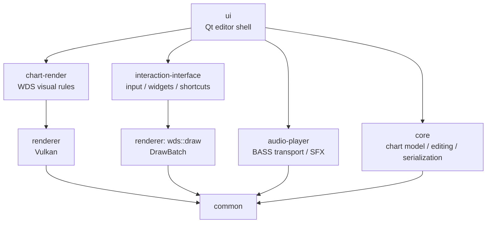

# WDS Editor

<p align="center">
  
</p>

<p align="center">
  <strong>A cross-platform custom chart editor for <em>World Dai Star: Yume no Stellarium</em> (YMST / ユメステ).</strong>
</p>

<p align="center">
  Native chart authoring · Official CSV / SUS interoperability · Realtime 3D preview · Audio-synchronized editing
</p>

<p align="center">
  <a href="./README.md"><strong>English</strong></a> ·
  <a href="./README-CN.md">简体中文</a>
</p>

<p align="center">
  <a href="https://github.com/TeamOpenSirius/wds-editor/releases"></a>
  <a href="https://github.com/TeamOpenSirius/wds-editor/actions/workflows/build-packages.yml"></a>
  
  
  
</p>

---

## Overview

**WDS Editor** is a desktop chart-authoring tool built for creating and previewing custom charts for **World Dai Star: Yume no Stellarium**.

The project provides a complete native editing workflow rather than only a format converter. Charts are authored on a tick-based timeline, synchronized with music, and rendered through a realtime 3D preview designed around the behavior and visual rules of the game.

WDS Editor has its own editable project/chart formats while also supporting interchange with existing WDS chart workflows:

- native **`.wdsproject`** projects;
- native editable **`.wdschart`** charts;
- decrypted official **7-column CSV** charts;
- **SUS** charts used by Ched / ChedPlus workflows;
- official **`music_config.csv`** timing data.

The codebase is intentionally split into reusable layers. Its chart core and rendering logic are also reused by related TeamOpenSirius projects such as [SiriusChartViewer](https://github.com/TeamOpenSirius/SiriusChartViewer).

## Highlights

- **Native custom-chart editing** on a tick-based timeline.
- **Realtime 3D preview** with game-oriented note, stage, split-line, and hit-effect rendering.
- **Music-synchronized playback** using BASS and a shared transport clock.
- **Multi-chart projects** — one song can contain multiple chart files.
- **Official CSV import/export**.
- **SUS import/export**, including metadata and Ched 12-key lane padding support.
- Optional **SUS → editable native chart** conversion.
- **Whole-project export** to official CSV or SUS layouts.
- **BPM and time-signature editing** with authored timing points.
- **Chart delay / music offset** support.
- **Undo / redo**, copy/paste, selection movement, resize, conversion, and mirroring.
- **Scratch Hold / JumpScratch editing** with chain-aware lane geometry.
- **Nontail Hold** support for duration-only holds without a judged tail.
- **Split lane / split effect** authoring.
- **Hold mid-star / soft-judge** handling, with independent Sound / SoundPurple conversion and Ched-like snapped placement.
- **Curve templates** for faster hold/scratch shape authoring.
- **Waveform and spectrum-assisted editing**.
- **Chart validation** with note-overlap detection and error highlighting.
- **Dockable Qt workspace** with configurable layout, theme, shortcuts, and editor behavior.
- Packaged releases for **Windows x86_64** and **macOS Apple Silicon**.

## Screens / Workspace

The editor uses a dockable Qt workspace. The default layout keeps the realtime preview, playback controls, chart editor, curve templates, and settings visible at the same time:

```text
┌──────────────────────────────────────────────────────────────────────────┐
│ File / Edit commands                Note conversion toolbar              │
├───────────────────┬──────────────────────────────┬───────────────────────┤
│ Realtime Preview  │                              │ Curve Templates       │
├───────────────────┤                              ├───────────────────────┤
│ Playback          │        Chart Editor          │ Settings              │
├───────────────────┤                              │                       │
│ Editor Toolbar    │                              │                       │
└───────────────────┴──────────────────────────────┴───────────────────────┘
```

Docks can be moved, floated, closed, nested, and restored through **View → Reset Layout**.

## Supported Formats

| Format | Import | Edit | Export | Purpose |
| --- | :---: | :---: | :---: | --- |
| `.wdsproject` | ✓ | ✓ | ✓ | Native project containing music, delay, and one or more charts |
| `.wdschart` | ✓ | ✓ | ✓ | Native editable chart format |
| Official WDS CSV | ✓ | Preview-only | ✓ | Interchange with decrypted game-style chart data |
| `music_config.csv` | ✓ | Delay metadata | ✓ | Official `DelaySeconds` / song timing configuration |
| `.sus` | ✓ | Optional conversion | ✓ | Ched / ChedPlus / SUS interoperability |

### Native `.wdsproject`

A native project references one song and one or more charts.

Conceptually:

```text
WDSPROJECT 2
MUSIC music.ogg
CHART_DELAY_MS 3019
ACTIVE_CHART 0
CHART chart-a.wdschart
CHART chart-b.wdschart
END
```

Paths are stored relative to the project file when possible, making projects easier to move as a directory.

### Native `.wdschart`

`.wdschart` is the editor's lossless authoring format.

Unlike the official CSV format, note timing is stored in integer **ticks** instead of absolute seconds. This keeps editing precise and supports authored BPM / meter changes without repeatedly quantizing to floating-point seconds.

The current format also preserves editor-specific relationships such as mid-star → parent-hold binding.

### Official CSV

WDS Editor understands the decrypted seven-column chart form:

```text
startTime,endTime,type,leftLane,laneLength,gimmickType,scratchLength
```

The actual official files do not contain a header; the line above only documents the column order.

Official CSV imports are intentionally **read-only / preview-oriented**. This avoids silently rewriting source data whose semantics may not map perfectly to the editor's native representation.

Editable charts can still be exported back to official CSV.

### SUS

The editor includes a dedicated SUS compatibility layer based on WDS/Sirius chart behavior and the Ched authoring conventions used by existing community workflows.

Supported behavior includes:

- Slide-based Hold / ScratchHold interpretation;
- Ched 12-key lane padding;
- Air (`#5`) geometry used for scratch behavior;
- Critical hold heads;
- visible hold mid-stars;
- HoldEighth generation during export;
- WDS-oriented metadata and wave offset handling.

Lossy or ambiguous SUS imports can return warnings rather than silently pretending the conversion is exact.

When **SUS auto-convert** is enabled, an imported SUS chart can be converted into an editable native chart in memory.

## Chart Model

WDS Editor models the major WDS note families used for authoring and interchange, including:

- Tap / Normal;
- Critical / ExTap;
- Flick — left, bidirectional, and right;
- Hold and Critical Hold;
- Scratch Hold and Scratch Critical Hold;
- Hold start / Scratch Hold start;
- Sound / ScratchSound mid-stars;
- HoldEighth soft-judge points;
- Nontail Hold variants;
- split-lane gimmicks;
- JumpScratch / OneDirection geometry.

The internal representation follows the game's lane semantics while using a normalized **0-based 12-lane editing space**.

### Scratch Hold chains

Scratch Hold editing is not treated as a generic ribbon only.

The core models:

- chained segment relationships;
- JumpScratch end spans;
- direction encoding;
- representable lane unions;
- shared chain joints;
- terminal end-cap geometry.

Dragging a chain segment is constrained to geometry that can still be represented by the WDS scratch-length model.

### Nontail Hold

Native note types include Nontail Hold variants:

```text
NontailHold
NontailCriticalHold
NontailScratchHold
NontailScratchCriticalHold
```

These are duration notes without a judged tail or end-hit effect, useful for custom-chart extensions where a hold should end without a normal tail judgment.

## Timing

The native editor is tick-based.

Each project/chart can use:

- configurable ticks per quarter note;
- BPM changes;
- time-signature changes;
- song-level chart delay;
- beat subdivisions for placement.

Tick `0` always has a timing anchor. Additional authored timing points can independently change BPM and/or meter.

The chart delay belongs to the **project**, not the `.wdschart` file. This makes it possible for several difficulties of the same song to share the same audio alignment.

## Editing Workflow

Typical workflow:

1. Create or open a `.wdsproject`.
2. Import/select the music file.
3. Set chart delay and timing.
4. Add one or more charts to the project.
5. Place and edit notes on the timeline.
6. Use the realtime preview to verify visuals and timing.
7. Run chart validation.
8. Save the native project.
9. Export the current chart or the whole project as official CSV or SUS.

### Core editing operations

The editor supports:

- click placement;
- drag placement for holds;
- selection and marquee selection;
- move selected notes;
- resize lane width;
- adjust hold duration;
- Scratch Hold end-span editing;
- delete;
- copy / paste;
- undo / redo;
- horizontal mirror;
- selection-centered mirror;
- tick/lane nudging;
- note-type conversion.

### Conversion toolbar

Selected notes can be quickly converted to:

- Tap;
- ExTap;
- Hold Head;
- Hold;
- Left Flick;
- Flick;
- Right Flick;
- Scratch Hold;
- Sound;
- SoundPurple.

The first eight buttons convert ordinary notes and holds. `Sound` / `SoundPurple` only convert between the two hold mid-star types: other notes are never turned into stars, and the ordinary buttons never turn a star body into a non-star note.

- Selecting a hold converts every child star inside it and leaves the hold body unchanged;
- Selecting a star body converts only that star;
- Hold → non-hold removes all child stars, HoldEighth rows and the paired head;
- Hold → hold keeps the existing behaviour: the head family is synchronized and child stars follow the target hold family;
- Mixed selections only apply those legal cases.

Stars no longer need to match the hold color family. Native `.wdschart` and official CSV import/export preserve mismatched star types; SUS/Ched still derives slide-mid color from the hold family (format limitation).

### Ched-like star placement

With **Ched-like placement logic** enabled, the conversion bar selects the placement type instead:

- `9` / `0` select `Sound` / `SoundPurple` by default and are configurable in the shortcut settings;
- the star's horizontal lane span always snaps to the hold under the pointer;
- outside a hold (including its start/end boundary ticks) no ghost is shown and placement is refused;
- placing a star regenerates that hold's HoldEighth rows in the same undo step.

## Curves

WDS Editor includes reusable **curve templates** for Hold / Scratch Hold authoring.

Templates can be selected from the editor toolbar and configured in the curve panel. Curve direction and parameters can be changed without manually rebuilding every intermediate segment.

This is designed to make repeated curved patterns substantially faster to author.

## Split Lanes

The editor understands the WDS split-lane gimmick families:

- Split;
- Full Split;
- Light Split;
- Ignore Split.

Split count and effect/color IDs are represented separately so preview behavior can follow the game's split-line rules.

The editor can optionally make newly placed notes follow the active split-track width.

## Realtime Preview

The preview path is driven by the same timeline used by the editor and audio transport:

```text
User input
  ↓
Audio Transport
  ↓
TimelineSnapshot
  ↓
ChartEditorEngine
  ↓
PreviewSnapshot
  ↓
PlaybackPreviewView / ChartPreviewPanel
  ↓
DrawBatch
  ↓
VulkanRenderer
```

The preview implements game-oriented visual logic instead of rendering generic editor rectangles only.

It includes:

- stage geometry;
- skinned notes;
- hold ribbons;
- Scratch Hold geometry;
- split lines and split colors;
- sync / concurrent lines;
- combo progression;
- auto-judgment effects;
- hit SFX scheduling.

The same preview core is reused by the web-based [SiriusChartViewer](https://github.com/TeamOpenSirius/SiriusChartViewer), where selected C++ components are compiled to WebAssembly.

## Audio

Audio playback is implemented through **BASS / BASSmix**.

The transport provides:

- music playback;
- hit SFX;
- seek;
- pause / resume;
- playback rate;
- music and SFX volume;
- shared timeline snapshots for the editor and preview.

Playback rate affects the BGM/timeline while hit SFX remain at their normal sample rate.

The editor also generates waveform data and supports spectrum-assisted chart editing.

## Chart Validation

The current validation layer includes note-overlap detection.

It checks simultaneous playable occupancies while accounting for special structures such as:

- hold bodies;
- judged hold tails;
- Scratch Hold tail spans;
- legal head/body pairs;
- chained hold joints;
- split gimmicks;
- mid-stars.

Detected error ticks can be highlighted directly in the editor.

## Keyboard Shortcuts

Common defaults include:

| Shortcut | Action |
| --- | --- |
| `Space` | Play / pause |
| `Ctrl/Cmd + O` | Open project |
| `Ctrl/Cmd + S` | Save |
| `Ctrl/Cmd + Z` | Undo |
| `Ctrl/Cmd + Y` | Redo |
| `Ctrl/Cmd + C` / `V` | Copy / paste |
| Arrow keys | Nudge selection |
| `Q / W / E / A / S / D` | Set default width to 1 / 2 / 3 / 4 / 6 / 12 |
| `9` / `0` | With Ched-like placement enabled, select Sound / SoundPurple placement |

Shortcuts are configurable in the editor settings.

## Installation

Prebuilt packages are available from [GitHub Releases](https://github.com/TeamOpenSirius/wds-editor/releases).

| Platform | Package | Notes |
| --- | --- | --- |
| Windows x86_64 | `wds-win-x86_64.msi` | Standard MSI installer |
| macOS Apple Silicon | `wds-macos-arm.dmg` | Drag `WDS Editor.app` into Applications |

### Graphics requirements

WDS Editor uses **Vulkan** for realtime rendering.

On Windows, install a current GPU driver with Vulkan support.

On macOS, releases target **Apple Silicon** and use **MoltenVK** over Metal.

### macOS Gatekeeper

If a downloaded application is blocked because of quarantine metadata, after moving it into `/Applications`:

```bash
xattr -cr "/Applications/WDS Editor.app"
```

## Build from Source

### Requirements

The project uses:

- C++17;
- CMake 3.16+;
- Qt 6.5+;
- Vulkan;
- libpng;
- glslang;
- BASS / BASSmix.

BASS runtime libraries for supported product targets are vendored under:

```text
audio-player/third_party/bass/
```

Machine-specific paths should go in a local environment file:

```bash
cp scripts/env.example scripts/env.local
```

Do not commit `scripts/env.local`.

### Supported product targets

| Target | Build host | Output |
| --- | --- | --- |
| `win-x86_64` | Linux x86_64 → MinGW cross-compile | MSI / portable ZIP |
| `macos-arm` | macOS Apple Silicon native | DMG / ZIP |

> Linux is currently a **build host**, not a supported desktop product target.

### macOS Apple Silicon

Install dependencies:

```bash
xcode-select --install
brew install cmake libpng glslang molten-vk vulkan-headers vulkan-loader qtbase qtsvg
```

Build:

```bash
./scripts/build-target.sh macos-arm
```

Debug build:

```bash
./scripts/build-target.sh macos-arm --debug
```

Artifacts:

```text
dist/wds-macos-arm.zip
dist/wds-macos-arm.dmg
```

### Linux → Windows x86_64

Typical host dependencies:

```bash
sudo apt install \
  mingw-w64 \
  g++-mingw-w64-x86-64 \
  cmake \
  ninja-build \
  zip \
  curl \
  msitools
```

A target Qt 6 MinGW installation and a vcpkg prefix containing at least `libpng`, `zlib`, and `vulkan-loader` are also required.

Configure `scripts/env.local`, for example:

```bash
WDS_VCPKG_ROOT="$HOME/src/vcpkg"
WDS_QT_MINGW_ROOT="/path/to/Qt/6.8.3/mingw_64"
QT_HOST_PATH="/path/to/Qt/6.8.3/gcc_64"
```

Then:

```bash
./scripts/build-target.sh --check
./scripts/build-target.sh win-x86_64
```

Artifacts:

```text
dist/wds-win-x86_64.msi
dist/wds-win-x86_64.zip
```

See [`cmake/CROSS_COMPILE.md`](./cmake/CROSS_COMPILE.md) for the full cross-compilation setup.

## Build Modes

| Mode | Build directory | Packaging | Logging |
| --- | --- | --- | --- |
| Release | `build-<target>/` | Yes | Runtime logging minimized |
| Debug | `build-<target>-debug/` | No by default | Verbose diagnostics |

Major modules can be toggled through:

```text
WDS_BUILD_COMMON
WDS_BUILD_CORE
WDS_BUILD_RENDERER
WDS_BUILD_AUDIO
WDS_BUILD_INTERACTION
WDS_BUILD_UI
```

A core-only build can disable renderer, interaction, and UI together.

## Tests

The product test gate currently runs natively on **macOS arm64**:

```bash
./scripts/build-target.sh macos-arm --no-package
ctest --test-dir build-macos-arm --output-on-failure
./scripts/build-target.sh --package-only macos-arm
```

The test suite covers areas including:

- common utilities;
- core chart editing;
- chart indexes;
- chart validation;
- audio transport and SFX;
- renderer logic;
- split-line behavior;
- note visual policy;
- interaction logic;
- editor configuration;
- chart-edit interactions;
- curve templates;
- draw ordering.

Windows packages are cross-compiled on Linux, so the Linux CI host does **not** run the resulting Windows PE test executables.

For host-only common/core tests on Linux:

```bash
./scripts/run-host-core-tests.sh
```

This is not equivalent to product runtime validation.

## Architecture

WDS Editor is structured as a modular C++ monorepo:



Lower layers must not depend back on the UI shell.

This separation allows the chart model and preview logic to be reused outside the desktop application.

## Repository Layout

```text
wds-editor/
├── common/                  Shared timing, logging, crash helpers
├── core/                    Chart model, editing, history, formats, preview snapshots
├── audio-player/            BASS audio engine and transport
├── renderer/                DrawBatch, texture management, Vulkan renderer
├── chart-render/            Stage geometry, skins, note/split visual policy
├── interaction-interface/   Input model, widgets, shortcuts, theme
├── ui/                      Qt application and dock-based editor shell
├── skins/                   Runtime note/stage skins
├── effects/                 Runtime hit SFX
├── icons/                   Source icons
├── cmake/                   Platform/toolchain configuration
└── scripts/                 Build, packaging, deployment, icon generation
```

Each major module has its own README describing its internal responsibilities and public APIs.

## Core API

The UI is built on top of a standalone chart-editing core.

Example:

```cpp
#include <wds/core/chart_editor_engine.hpp>

wds::chart_editor::ChartEditorEngine engine;

const int32_t id = engine.add_note(note);
engine.update_note(id, edited_note);
engine.remove_note(id);

engine.seek(12345);
const auto& snapshot = engine.snapshot();

engine.save_to_file(path);
engine.load_from_file(path);
```

The core layer has no dependency on Qt, Vulkan, BASS, or a window system.

This makes it useful for converters, validators, headless tools, and alternate frontends.

## Relationship to SiriusChartViewer

[SiriusChartViewer](https://github.com/TeamOpenSirius/SiriusChartViewer) reuses the WDS Editor preview core in the browser.

Selected C++ sources from this repository are compiled with Emscripten to WebAssembly, while rendering is adapted to WebGL2 and audio timing to the Web Audio API.

Keeping the chart model and preview behavior centralized here reduces divergence between desktop and web previews.

## CI and Releases

GitHub Actions builds packages on pushes to `dev` and `main`.

The pipeline currently:

- cross-compiles Windows x86_64 on Ubuntu;
- builds and tests macOS arm64 natively;
- produces MSI / DMG artifacts;
- publishes a GitHub Release from successful `main` builds.

Workflow:

[`/.github/workflows/build-packages.yml`](./.github/workflows/build-packages.yml)

## Known Limitations

- **Linux is not currently a desktop product target.**
- Official CSV imports are preview/read-only rather than native editable documents.
- Official `HiSpeed` rows are currently skipped by default; the editor does not yet provide a general authored time-scale channel.
- Some SUS constructs can be lossy when mapped to WDS semantics; import warnings are preserved for these cases.
- Exact audio format support depends on the bundled BASS runtime and platform codecs.
- The editor targets custom-chart authoring and interoperability; it is not an official game tool.

## Contributing

Issues and pull requests are welcome.

For chart-format and game-behavior changes, prefer evidence from observed WDS behavior, client structures, known chart data, or reproducible compatibility tests over guessed semantics.

When changing the chart core:

- keep UI-specific behavior out of `core/`;
- preserve serialization compatibility where possible;
- add or update tests for format behavior and editing rules;
- keep desktop preview behavior compatible with downstream users such as SiriusChartViewer.

## Licensing

WDS Editor is licensed under the **GNU Lesser General Public License version 3 or later** (LGPLv3+). See `LICENSE`, `COPYING.LESSER`, and `COPYING` at the repository root.

Packaged builds ship third-party license texts under `licenses/` (copied into the app resource tree). Qt, the OBS Yami theme, FFmpeg, BASS/BASSmix, MoltenVK, fonts, icons, and other dependencies remain under their own terms; see Help → About and `licenses/README.txt`.

## Disclaimer

WDS Editor is an unofficial community project.

*World Dai Star*, *World Dai Star: Yume no Stellarium*, ユメステ, and related names, assets, game data, and trademarks belong to their respective rights holders. This project is not affiliated with or endorsed by the official developers, publishers, or operators.
